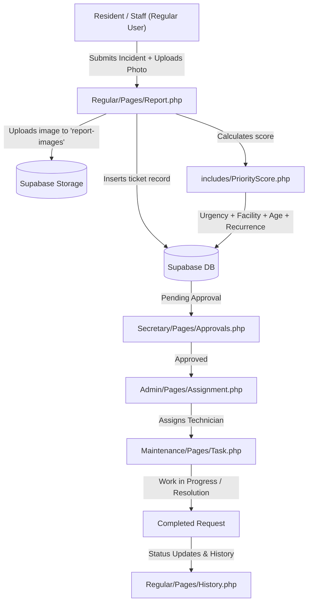

# MaintainTrack

**MaintainTrack** is a barangay facility and equipment maintenance management system built with PHP and backed by Supabase (PostgreSQL, Supabase Auth, and Supabase Storage). The platform provides end-to-end incident reporting, automated priority queueing, administrative assignment, technician task management, and secretary approvals across four dedicated user roles.

---

## Table of Contents

- [Overview](#overview)
- [Key Features & Role Portals](#key-features--role-portals)
- [System Architecture](#system-architecture)
  - [Supabase Backend & Storage](#supabase-backend--storage)
  - [Role-Separated Session Management](#role-separated-session-management)
  - [Priority Scoring & Queueing Engine](#priority-scoring--queueing-engine)
  - [UI Customization & Preferences](#ui-customization--preferences)
- [Project Directory Structure](#project-directory-structure)
- [Local Setup & Prerequisites](#local-setup--prerequisites)
- [Request & Workflow Lifecycle](#request--workflow-lifecycle)
- [Developer Guide](#developer-guide)

---

## Overview

MaintainTrack coordinates maintenance operations for local barangay facilities, offices, and public amenities. It streamlines communication between residents/staff reporting issues, barangay secretaries approving requests, administrators dispatching personnel, and maintenance workers resolving field tasks.

---

## Key Features & Role Portals

MaintainTrack contains four role-specific environments:

| Role | Page Prefix | Primary Responsibilities | Key Pages |
| :--- | :--- | :--- | :--- |
| **Administrator** | `pages/admin/` | Full system control, request triage, technician dispatching, equipment cataloging, user management, and analytics reports. | `admin_dashboard.php`<br>`admin_request.php`<br>`admin_assignment.php`<br>`admin_registry.php`<br>`admin_report.php`<br>`admin_users.php`<br>`admin_notification.php`<br>`admin_profile.php` |
| **Secretary** | `pages/secretary/` | Reviewing incoming maintenance requests, validating submissions, granting approvals, and tracking resolution history. | `secretary_dashboard.php`<br>`secretary_approvals.php`<br>`secretary_history.php`<br>`secretary_notification.php`<br>`secretary_profile.php` |
| **Maintenance** | `pages/maintenance/` | Monitoring facility status, viewing assigned work orders, updating task progress, and documenting resolutions. | `maintenance_dashboard.php`<br>`maintenance_facility.php`<br>`maintenance_task.php`<br>`maintenance_request.php`<br>`maintenance_notification.php`<br>`maintenance_profile.php` |
| **Regular User** | `pages/regular/` | Submitting maintenance reports with photo attachments, viewing live ticket statuses, and reviewing past issue history. | `regular_dashboard.php`<br>`regular_report.php`<br>`regular_request.php`<br>`regular_history.php`<br>`regular_notification.php`<br>`regular_profile.php` |

---

## System Architecture

### Supabase Backend & Storage

MaintainTrack connects directly to Supabase via server-side PHP cURL routines (`Config/supabase.php`):
- **Database (PostgreSQL via REST API):** Manages `users`, `facilities`, `facility_floors`, `facility_rooms`, `equipment`, and `maintenance_requests`.
- **Authentication (Supabase Auth):** Authenticates user credentials via Supabase token endpoints while keeping server secrets safe from browser execution.
- **Storage Bucket (`report-images`):** Handles image uploads for incident reports, automatically rolling back uploads if record creation fails.

### Role-Separated Session Management

Standard PHP sessions share a single cookie across browser tabs. In multi-role environments, this causes session collisions when logging into multiple roles simultaneously.

MaintainTrack uses **role-isolated session cookies** via `includes/session.php`:
- `MTSESS_admin`
- `MTSESS_secretary`
- `MTSESS_regular`
- `MTSESS_maintenance`

Session names are resolved automatically from the URL path or query parameter, allowing concurrent logins across roles in the same browser without interference. Individual roles can be logged out cleanly via `Logout.php?role={role}` without terminating other active role sessions.

### Priority Scoring & Queueing Engine

Incoming maintenance reports are automatically scored and prioritized by the algorithm in `includes/PriorityScore.php` (referenced in `docs/Priority_Level_Map.pdf`):

$$\text{Score} = (0.40 \times \text{Urgency}) + (0.25 \times \text{Facility}) + (0.20 \times \text{Age}) + (0.15 \times \text{Recurrence})$$

- **Urgency (40%):** Scaled 1–3 (`High` = 3, `Medium` = 2, `Low` = 1; Admin manual override `Urgent` = 4).
- **Facility Importance (25%):** Priority weighted by facility/room type (e.g., Records, Laboratory, Server Room = 3; Offices/Halls = 2; Hallways, Courts, Storage = 1).
- **Age Protection (20%):** Waiting time in days (scaled up to 10 days max) to prevent low-urgency ticket starvation.
- **Recurrence (15%):** Checks for repeated failures of the same equipment within the last 30 days (capped at 3 occurrences).

### UI Customization & Preferences

User display preferences are managed in `Components/Settings.php` and persisted in role-scoped browser cookies (`{role}_font_size`, `{role}_content_size`, `{role}_background`, etc.):
- **Typography & Scale:** `small`, `medium`, `large` font scaling and content padding.
- **Sidebar Modes:** Full sidebar, compact sidebar, and hover-retractable sidebar.
- **Themes & Backgrounds:** Default radial, Barangay Building, Blurry Cloud, Classic Blue, Classic Waves, and Terrain Map.

---

## Project Directory Structure

```text
Sia/
├── Index.php                      # Application login interface and modal messages
├── Login.php                      # Supabase Auth verification & role session initializer
├── Logout.php                     # Role-targeted session termination
├── README.md                      # Project documentation
│
├── Config/
│   ├── supabase.php               # Supabase credentials, REST API client, and Storage configs
│   └── test_supabase.php          # Diagnostic test utility for cURL & Supabase connectivity
│
├── includes/                      # Backend helpers (no HTML)
│   ├── session.php                # Multi-role isolated PHP session handler
│   ├── PriorityScore.php          # Priority calculation formula and priority queue helpers
│   ├── data.php                   # Demo dataset fallbacks
│   └── profile_api.php            # Profile save / change-password endpoints
│
├── Components/                    # Reusable UI partials
│   ├── layout.php                 # Page head/foot, navigation, asset versioning, role guard
│   ├── notification_view.php      # Reusable notification UI helpers
│   └── {admin,secretary,regular,maintenance}_{navbar,sidebar}.php
│
├── pages/
│   ├── settings.php               # Shared display settings (?role=...)
│   ├── admin/                     # admin_*.php
│   ├── secretary/                 # secretary_*.php
│   ├── regular/                   # regular_*.php
│   └── maintenance/               # maintenance_*.php
│
├── assets/
│   ├── css/                       # base.css, uniform.css, Sidebar.css, Style.css and <role>_*.css
│   ├── js/                        # RoleNavigation.js, ProfileEdit.js
│   └── images/                    # Logo, backgrounds, loading.svg
│
└── docs/                          # Priority_Level_Map.pdf, importante.txt (to-do notes)
```

---

## Local Setup & Prerequisites

### 1. Requirements

- **Web Server:** XAMPP, WampServer, Laragon, or standalone Apache.
- **PHP Version:** PHP 8.0 or newer.
- **PHP Extensions:** `php_curl` (required for Supabase API and Auth communications), `json`, `mbstring`, `session`.

> [!IMPORTANT]
> Verify that `extension=curl` is enabled in your `php.ini` configuration. Without cURL, Supabase authentication and database queries will fail.

### 2. Installation Steps

1. Clone or copy the project into your local server web directory:
   ```text
   C:\xampp\htdocs\Sia
   ```
2. Start the **Apache** service in the XAMPP Control Panel. (Local MySQL is not required as the database is hosted on Supabase).
3. Review or update your Supabase credentials in `Config/supabase.php`:
   - `SUPABASE_URL`
   - `SUPABASE_ANON_KEY`
   - `SUPABASE_SECRET_KEY`
   - `SUPABASE_STORAGE_BUCKET`
4. Verify environment connectivity by opening the diagnostic tool in your browser:
   ```text
   http://localhost/Sia/Config/test_supabase.php
   ```
5. Launch the application login:
   ```text
   http://localhost/Sia/Index.php
   ```

---

## Request & Workflow Lifecycle



1. **Submission:** A user files a maintenance report (`Regular/Pages/Report.php`) selecting facility, floor, room, and equipment, with an optional photo.
2. **Prioritization:** `PriorityScore.php` calculates an initial priority score based on urgency keywords, room sensitivity, and past failure history.
3. **Approval:** The Barangay Secretary reviews and validates the ticket in `Secretary/Pages/Approvals.php`.
4. **Assignment:** The Admin reviews the prioritized queue in `Admin/Pages/Assignment.php` and dispatches an available maintenance worker.
5. **Execution & Completion:** The maintenance technician manages and updates the task in `Maintenance/Pages/Task.php`, recording resolution details upon completion.

---

## Developer Guide

### Adding a New Page

To create a new page under any role:

1. Create the PHP file in the corresponding role's `Pages/` directory (e.g., `Secretary/Pages/Analytics.php`).
2. Include the shared helpers:
   ```php
   <?php
   declare(strict_types=1);

   require_once __DIR__ . '/../../includes/session.php';
   require_once __DIR__ . '/../../Components/layout.php';
   require_once __DIR__ . '/../../Config/supabase.php';

   renderHead('Page Title', 'Components/css/OptionalPageStyle.css', 'secretary');
   ?>

   <main class="page-container">
       <?= renderPageHeader('Page Heading', 'Short description of this page.') ?>
       <!-- Page contents here -->
   </main>

   <?php
   renderFoot();
   ```
3. To add the page to the sidebar/navigation menu, add an entry to `roleNavigationItems()` inside `Components/layout.php`:
   ```php
   ['label' => 'Analytics', 'href' => 'Analytics.php', 'icon' => '<svg path here>'],
   ```
4. Place any page-specific stylesheet under that role's `Components/css/` directory.

> [!IMPORTANT]
> Verify that `extension=curl` is enabled in your `php.ini` configuration. Without cURL, Supabase authentication and database queries will fail.

### 2. Installation Steps

1. Clone or copy the project into your local server web directory:
   ```text
   C:\xampp\htdocs\Sia
   ```
2. Start the **Apache** service in the XAMPP Control Panel. (Local MySQL is not required as the database is hosted on Supabase).
3. Review or update your Supabase credentials in `Config/supabase.php`:
   - `SUPABASE_URL`
   - `SUPABASE_ANON_KEY`
   - `SUPABASE_SECRET_KEY`
   - `SUPABASE_STORAGE_BUCKET`
4. Verify environment connectivity by opening the diagnostic tool in your browser:
   ```text
   http://localhost/Sia/Config/test_supabase.php
   ```
5. Launch the application login:
   ```text
   http://localhost/Sia/Index.php
   ```

---

## Request & Workflow Lifecycle


1. **Submission:** A user files a maintenance report (`Regular/Pages/Report.php`) selecting facility, floor, room, and equipment, with an optional photo.
2. **Prioritization:** `PriorityScore.php` calculates an initial priority score based on urgency keywords, room sensitivity, and past failure history.
3. **Approval:** The Barangay Secretary reviews and validates the ticket in `Secretary/Pages/Approvals.php`.
4. **Assignment:** The Admin reviews the prioritized queue in `Admin/Pages/Assignment.php` and dispatches an available maintenance worker.
5. **Execution & Completion:** The maintenance technician manages and updates the task in `Maintenance/Pages/Task.php`, recording resolution details upon completion.

---

## Developer Guide

### Adding a New Page

To create a new page under any role:

1. Create the PHP file in the corresponding role's `Pages/` directory (e.g., `Secretary/Pages/Analytics.php`).
2. Include the shared helpers:
   ```php
   <?php
   declare(strict_types=1);

   require_once __DIR__ . '/../../includes/session.php';
   require_once __DIR__ . '/../../Components/layout.php';
   require_once __DIR__ . '/../../Config/supabase.php';

   renderHead('Page Title', 'Components/css/OptionalPageStyle.css', 'secretary');
   ?>

   <main class="page-container">
       <?= renderPageHeader('Page Heading', 'Short description of this page.') ?>
       <!-- Page contents here -->
   </main>

   <?php
   renderFoot();
   ```
3. To add the page to the sidebar/navigation menu, add an entry to `roleNavigationItems()` inside `Components/layout.php`:
   ```php
   ['label' => 'Analytics', 'href' => 'Analytics.php', 'icon' => '<svg path here>'],
   ```
4. Place any page-specific stylesheet under that role's `Components/css/` directory.

