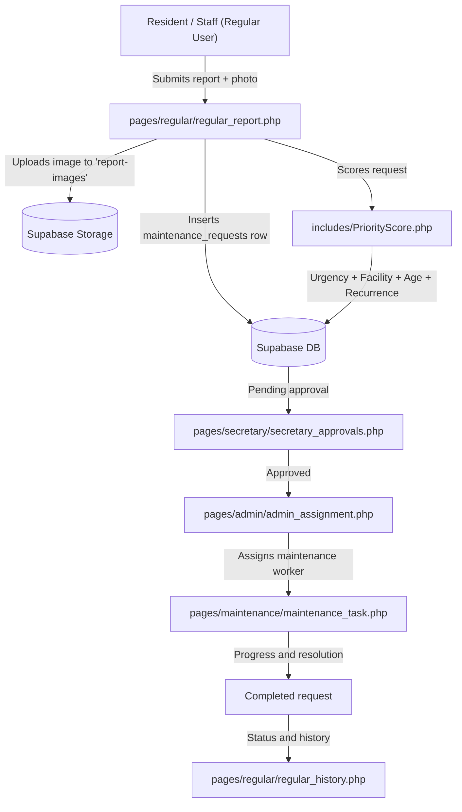

# MaintainTrack (Sia)

**MaintainTrack** is a barangay facility and equipment maintenance management system built with PHP 8 and backed by Supabase (PostgreSQL through the REST API, Supabase Auth, and Supabase Storage). It covers incident reporting with photos, automatic priority scoring, secretary approval, administrative dispatch to maintenance workers, field task updates, and a treasurer module for the bodega (stock) inventory.

---

## Table of Contents

- [Overview](#overview)
- [Roles and Portals](#roles-and-portals)
- [System Architecture](#system-architecture)
  - [Supabase Backend and Storage](#supabase-backend-and-storage)
  - [Role-Separated Sessions](#role-separated-sessions)
  - [Priority Scoring and Queue](#priority-scoring-and-queue)
  - [Bodega (Treasurer Inventory)](#bodega-treasurer-inventory)
  - [Display Settings](#display-settings)
  - [Role Guard and Layout](#role-guard-and-layout)
- [Project Structure](#project-structure)
- [Local Setup](#local-setup)
- [Request and Workflow Lifecycle](#request-and-workflow-lifecycle)
- [Developer Guide](#developer-guide)
- [Known Notes](#known-notes)

---

## Overview

MaintainTrack coordinates maintenance for barangay facilities, offices, and public amenities. Residents and staff report problems, the barangay secretary validates and approves them, the administrator prioritizes and dispatches maintenance workers, and the workers resolve the field tasks. The treasurer manages the bodega's stock of supplies, equipment borrowing and returns, procurement, and stock history.

---

## Roles and Portals

There are five roles. Each has its own folder under `pages/`, its own session cookie, and its own stylesheets.

| Role              | Page folder          | Responsibilities                                                                                         | Main pages                                                                                                                                                                                            |
| :---------------- | :------------------- | :------------------------------------------------------------------------------------------------------- | :---------------------------------------------------------------------------------------------------------------------------------------------------------------------------------------------------- |
| **Administrator** | `pages/admin/`       | Request triage, technician dispatch, equipment registry, user management, analytics and reports.         | `admin_dashboard.php`, `admin_request.php`, `admin_assignment.php`, `admin_registry.php`, `admin_report.php`, `admin_analytics.php`, `admin_users.php`, `admin_notification.php`, `admin_profile.php` |
| **Secretary**     | `pages/secretary/`   | Validates incoming requests, grants approvals, and tracks resolution history.                            | `secretary_dashboard.php`, `secretary_approvals.php`, `secretary_requestdetails.php`, `secretary_history.php`, `secretary_notification.php`, `secretary_profile.php`                                  |
| **Maintenance**   | `pages/maintenance/` | Monitors facility status, works assigned tasks, records progress and resolutions.                        | `maintenance_dashboard.php`, `maintenance_facility.php`, `maintenance_task.php`, `maintenance_request.php`, `maintenance_analytics.php`, `maintenance_notification.php`, `maintenance_profile.php`    |
| **Regular user**  | `pages/regular/`     | Submits reports with photo attachments, follows ticket status, reviews past reports.                     | `regular_dashboard.php`, `regular_report.php`, `regular_request.php`, `regular_maintenance.php`, `regular_history.php`, `regular_notification.php`, `regular_profile.php`                             |
| **Treasurer**     | `pages/treasurer/`   | Bodega stock: inventory items, borrow and return of returnable items, procurement, and movement history. | `treasurer_dashboard.php`, `treasurer_inventory.php`, `treasurer_borrow.php`, `treasurer_procurement.php`, `treasurer_history.php`, `treasurer_notification.php`, `treasurer_profile.php`             |

Shared pages (not tied to one role) are `Index.php`, `Login.php`, `Logout.php`, and `pages/settings.php`.

---

## System Architecture

### Supabase Backend and Storage

The server reaches Supabase with PHP cURL through `Config/supabase.php`:

- **Database (PostgreSQL via REST, `/rest/v1/`):** core tables `users`, `facilities`, `facility_floors`, `facility_rooms`, `equipment`, `maintenance_requests`, `assignments`, `request_timeline`, `maintenance_updates`, `maintenance_rejections`, `activity_log`, `notifications`; bodega tables `inventory_items`, `inventory_transactions`, `procurements`; and reporting views `recurring_equipment`, `request_summary`, `staff_open_tasks`.
- **Authentication (Supabase Auth, `/auth/v1/`):** login checks run on the server, so the secret key never reaches the browser.
- **Storage (`/storage/v1/`):**
  - `report-images`: photos attached to incident reports. The upload is rolled back if the record insert fails.
  - `equipment-images`: equipment photos used by the registry.
  - `bodega-documents`: documents attached to bodega records.

> [!WARNING]
> `Config/supabase.php` contains the Supabase keys in plain text. Keep this repository private, and move the secret key to an environment variable or a file outside the web root before sharing or deploying the project.

### Role-Separated Sessions

Normal PHP sessions share one cookie, so logging in as a second role in the same browser would overwrite the first. `includes/session.php` gives each role its own session:

- `MTSESS_admin`, `MTSESS_secretary`, `MTSESS_regular`, `MTSESS_maintenance`, `MTSESS_treasurer`

The role is read from the page's folder or filename prefix, or from `?role=` on the shared pages (`Logout.php`, `pages/settings.php`). Use `Logout.php?role={role}` to end one role's session without affecting the others.

### Priority Scoring and Queue

`includes/PriorityScore.php` ranks each request. The documented formula is in `docs/Priority_Level_Map.pdf`:

$$\text{Score} = (0.40 \times \text{Urgency}) + (0.25 \times \text{Facility}) + (0.20 \times \text{Age}) + (0.15 \times \text{Recurrence})$$

- **Urgency (40%):** `High` = 3, `Medium` = 2, `Low` = 1. An admin can set `Urgent` = 4.
- **Facility importance (25%):** Rules are matched on the room or facility name. Records, laboratory, and server-room style rooms weigh highest, offices and halls are medium, and hallways, courts, and storage are lowest. Unmatched rooms use a default of 2.
- **Age (20%):** Days waiting, capped at 10 and scaled to 1–3, so low-urgency items are not starved.
- **Recurrence (15%):** Other reports on the same equipment in the last 30 days, capped at 3 and scaled to 1–3.

The total becomes a level: `High` at 2.2 or more, `Medium` at 1.6 or more, and `Low` below that. `PriorityScore.php` also builds the priority queue (a max-heap, highest score first) for the admin assignment page.

`includes/DuplicateReport.php` flags reports that look like duplicates of an open report, so the admin can review them before dispatch.

### Bodega (Treasurer Inventory)

`includes/bodega.php` is the data layer for the treasurer pages. It finds the ground-floor bodega room by name (a case-insensitive match on `*bodega*`) and works only on items in that room.

Stock rules:

- **Consumable** items are used up. A use is final and reduces stock.
- **Returnable** items are borrowed and returned. A borrow reduces stock, and a return adds it back.
- **Procurement** adds stock and logs a `stock_in` movement.
- Every change is written to `inventory_transactions`.

The bodega pages use Post/Redirect/Get. Flash messages are kept in `$_SESSION['bodega_flash']` and shown after the redirect.

The Borrow/Return page loads maintenance workers from `users` (role = `maintenance`, status = `Active`) for the worker dropdown.

### Display Settings

`pages/settings.php` saves each role's display preferences in cookies named `{role}_font_size`, `{role}_content_size`, `{role}_layout`, `{role}_background`, and similar keys:

- **Font and content scale:** small, medium, large.
- **Sidebar mode:** full, compact, or hover-retractable.
- **Background:** default radial, Barangay Building, Blurry Cloud, Classic Blue, Classic Waves, Terrain Map.

Only known option values are accepted from the request.

### Role Guard and Layout

`Components/layout.php` provides:

- `renderHead($title, $cssFile, $role)` and `renderFoot()`, which output the page shell, stylesheets, and scripts.
- `renderPageHeader($title, $subtitle, $role)`.
- `roleNavigationItems()`, which defines the sidebar entries for each role.
- `enforceFolderRole()`, which blocks a page from being opened by the wrong role, based on the folder or the `admin_`, `secretary_`, `regular_`, `maintenance_`, or `treasurer_` filename prefix.

Each role has its own navbar and sidebar partial in `Components/`.

---

## Project Structure

```text
Sia/
├── Index.php                      # Login page and modal messages
├── Login.php                      # Supabase Auth check and role session setup
├── Logout.php                     # Ends one role's session (?role=...)
├── README.md
│
├── Config/
│   ├── supabase.php               # Supabase URL, keys, REST/Storage client, bucket names
│   └── test_supabase.php          # Connectivity diagnostic for cURL and Supabase
│
├── includes/                      # Backend helpers, no HTML
│   ├── session.php                # Role-isolated session handler
│   ├── PriorityScore.php          # Priority formula, levels, and queue builder
│   ├── DuplicateReport.php        # Duplicate-report detection
│   ├── bodega.php                 # Treasurer bodega data layer
│   ├── data.php                   # Demo data fallbacks
│   └── profile_api.php            # Profile save and change-password endpoints
│
├── Components/                    # Shared layout and role partials
│   ├── layout.php                 # Page head/foot, navigation, role guard, asset versioning
│   ├── notification_view.php      # Notification UI helpers
│   └── {admin,secretary,regular,maintenance,treasurer}_{navbar,sidebar}.php
│
├── pages/
│   ├── settings.php               # Display settings (?role=...)
│   ├── admin/                     # admin_*.php
│   ├── secretary/                 # secretary_*.php
│   ├── regular/                   # regular_*.php
│   ├── maintenance/               # maintenance_*.php
│   └── treasurer/                 # treasurer_*.php
│
├── assets/
│   ├── css/                       # Shared: base.css, uniform.css, Sidebar.css, Style.css,
│   │                              #   Settings.css, NotificationShared.css
│   │   ├── admin/                 # admin_*.css
│   │   ├── secretary/             # secretary_*.css
│   │   ├── regular/               # regular_*.css
│   │   ├── maintenance/           # maintenance_*.css
│   │   └── treasurer/             # treasurer_*.css
│   ├── js/                        # RoleNavigation.js, ProfileEdit.js
│   ├── images/                    # Logo, backgrounds, loading.svg
│   └── notif.mp3                  # Notification sound
│
└── docs/                          # Priority_Level_Map.pdf, importante.txt (to-do notes)
```

---

## Local Setup

### 1. Requirements

- **Web server:** XAMPP, WampServer, Laragon, or standalone Apache.
- **PHP:** 8.0 or newer.
- **PHP extensions:** `curl` (required for all Supabase calls), `json`, `mbstring`, `session`.

> [!IMPORTANT]
> Make sure `extension=curl` is enabled in `php.ini`. Without cURL, Supabase login and database calls fail.

### 2. Installation

1. Copy the project into your web root, for example `C:\xampp\htdocs\Sia`.
2. Start **Apache** in the XAMPP Control Panel. A local MySQL server is not needed, because the database is hosted on Supabase.
3. Set the Supabase values in `Config/supabase.php`:
   - `SUPABASE_URL`
   - `SUPABASE_ANON_KEY`
   - `SUPABASE_SECRET_KEY`
   - `SUPABASE_STORAGE_BUCKET` (currently `report-images`)
4. Check connectivity at `http://localhost/Sia/Config/test_supabase.php`.
5. Open the login page at `http://localhost/Sia/Index.php`.

---

## Request and Workflow Lifecycle



1. **Submission:** A user files a report (`regular_report.php`) with facility, floor, room, equipment, and an optional photo.
2. **Scoring:** `PriorityScore.php` calculates the priority from urgency, facility, age, and recurrence.
3. **Approval:** The secretary reviews and approves the request in `secretary_approvals.php`.
4. **Assignment:** The admin reviews the priority queue in `admin_assignment.php` and dispatches an available maintenance worker.
5. **Execution:** The worker updates progress and records the resolution in `maintenance_task.php`.

Separately, the treasurer records bodega movements (borrow, return, use, procurement) in the treasurer pages, and every movement appears in `treasurer_history.php`.

---

## Developer Guide

### Adding a New Page

1. Create the file in the role's folder and name it with the role prefix, for example `pages/secretary/secretary_analytics.php`. The prefix is what the role guard checks.
2. Use the shared helpers:

   ```php
   <?php
   require_once __DIR__ . '/../../includes/session.php';
   require_once __DIR__ . '/../../Components/layout.php';
   require_once __DIR__ . '/../../Config/supabase.php';

   renderHead('Analytics', 'secretary/secretary_Analytics.css', 'secretary');
   ?>
   <div class="page">
       <div class="one-card">
           <?php renderPageHeader('Analytics', 'Short description of this page.', 'secretary'); ?>
           <!-- Page content -->
       </div>
   </div>
   <?php renderFoot(); ?>
   ```

3. Add the sidebar entry in `roleNavigationItems()` inside `Components/layout.php`:

   ```php
   ['label' => 'Analytics', 'href' => 'secretary_analytics.php', 'icon' => '<svg>...</svg>'],
   ```

4. Put page-specific styles in `assets/css/<role>/`, named `<role>_<Page>.css`. The stylesheet path passed to `renderHead()` is relative to `assets/css/`.

> [!IMPORTANT]
> Keep `Config/supabase.php` values out of documentation, screenshots, and commits.

---

## Known Notes

- **Leftover archives:** `pages/admin.zip`, `pages/maintenance.zip`, and `pages/regular.zip` are old copies of the page folders. They are not used by the app and can be deleted once you confirm the matching folders are complete.
- **Hardcoded keys:** The Supabase secret key is stored in `Config/supabase.php`. See the warning in [Supabase Backend and Storage](#supabase-backend-and-storage).
- **Open to-do items:** `docs/importante.txt` lists pending work, including dropdown placeholder fixes, notification fixes, the mobile layout plan, and filter and reset behavior.
